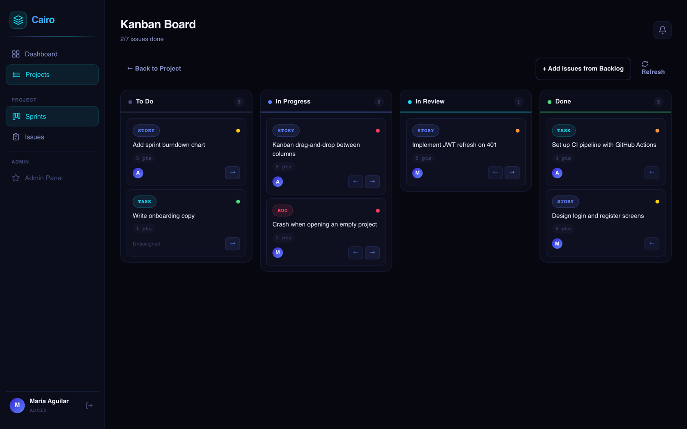
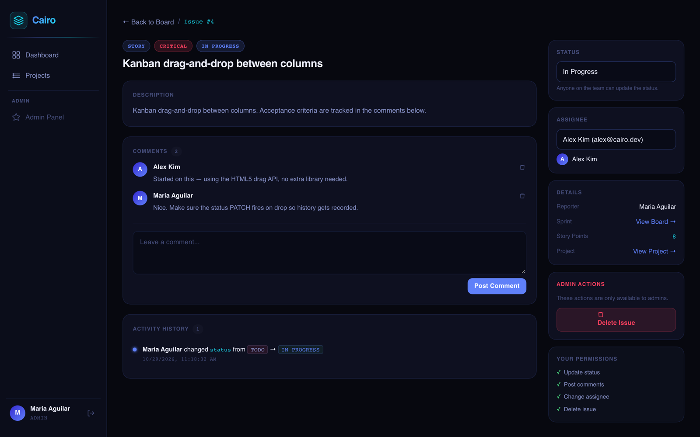
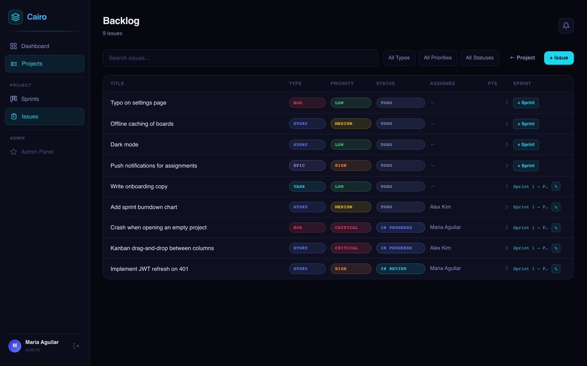
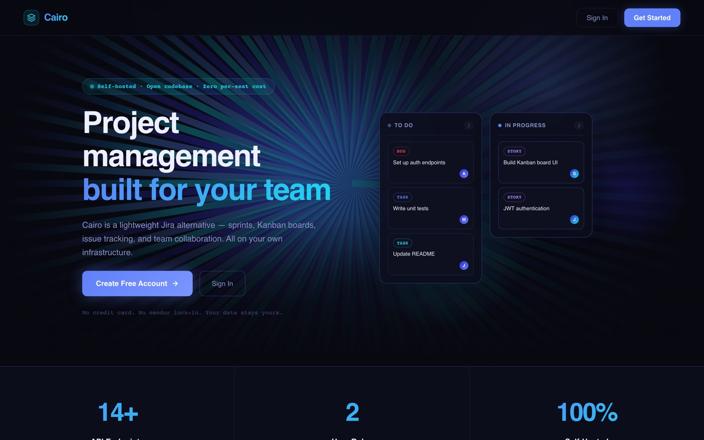
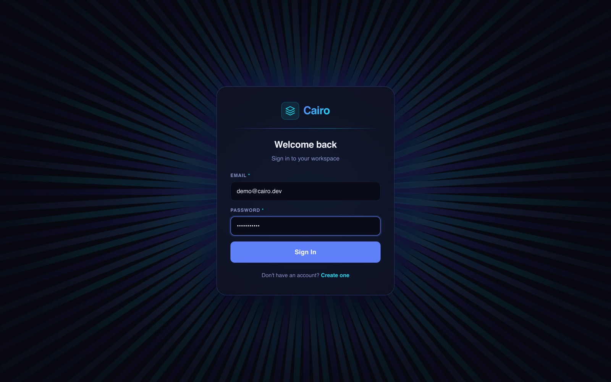
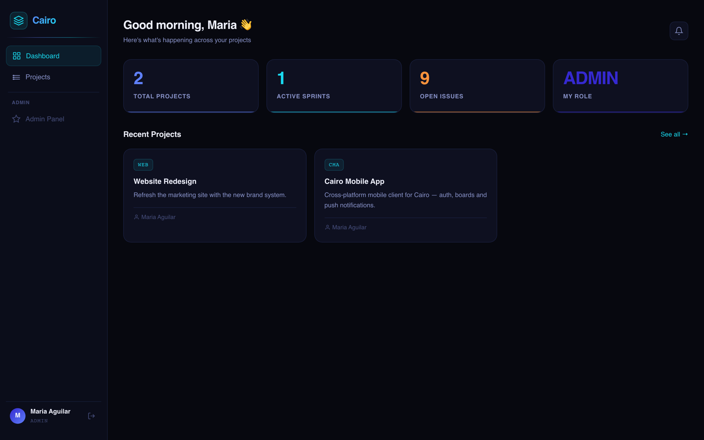
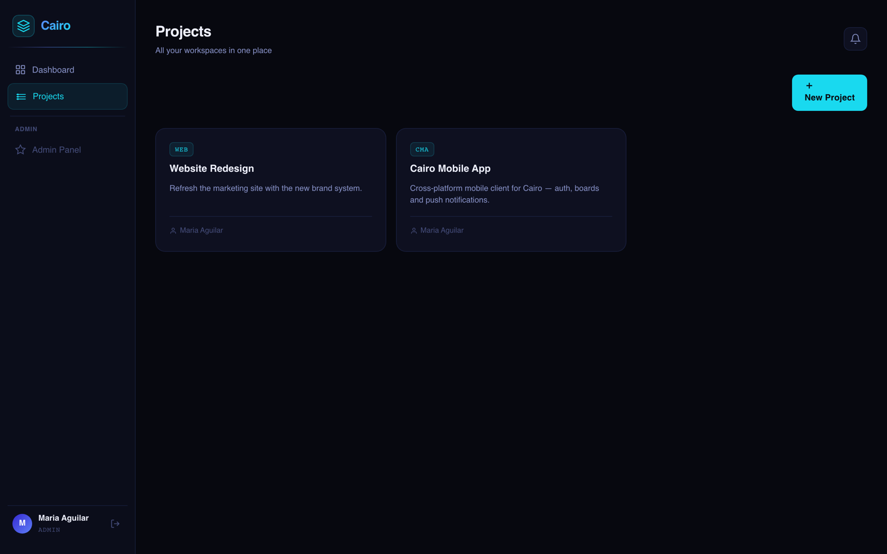
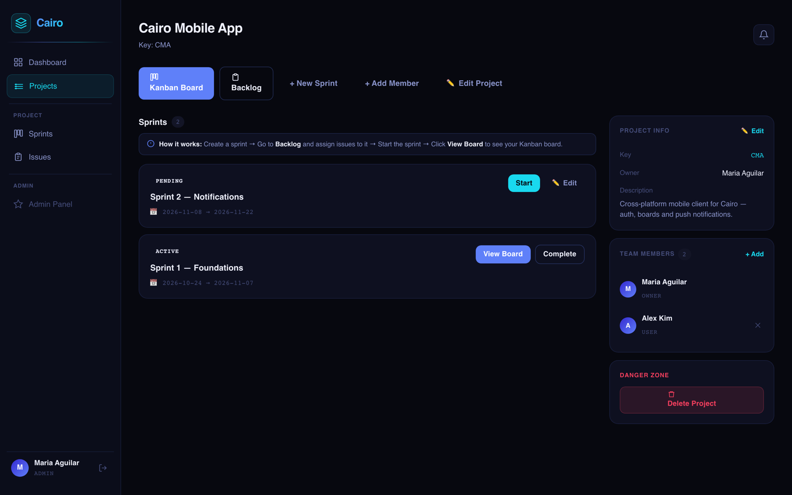
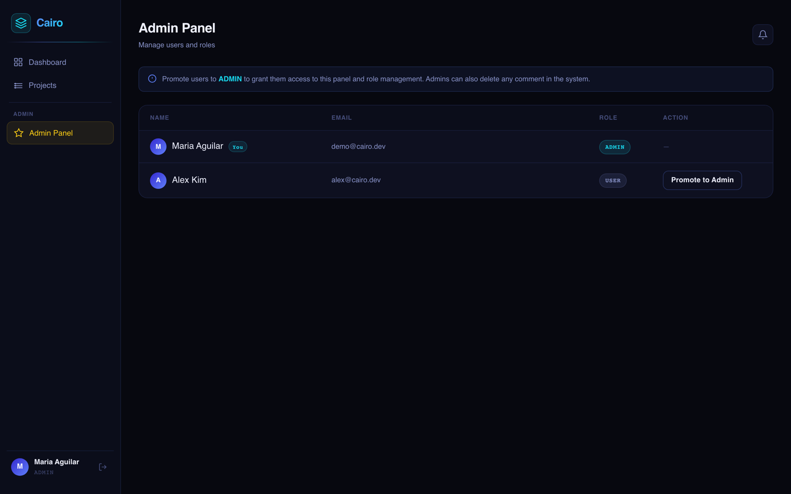

# Cairo Backend

Cairo is a Jira-style project management and issue tracking API. This repo is its backend, built with Spring Boot. Users can register, create projects, invite members, track issues through a backlog and sprints, move work across a Kanban board, comment on issues, and get notifications when something changes on work assigned to them.

> **Where's the frontend?** The React + Vite frontend is on the [`master`](https://github.com/Mariaa97-rodri/Cairo-Capstone/tree/master) branch of this repo. `main` holds the backend only. See [Running the Frontend](#running-the-frontend).

## Screenshots

### Kanban board
The active sprint's issues grouped by status, with type, priority, story points and assignee on each card.



### Issue detail
Description, comments, the audit trail of status changes, and controls for status, assignee and admin actions.



### Backlog
Every issue in the project, with search and filters for type, priority and status. Issues not yet in a sprint can be added from here.



<details>
<summary><strong>More screenshots</strong> (landing page, login, dashboard, projects, project detail, admin panel)</summary>

#### Landing page


#### Login


#### Dashboard


#### Projects


#### Project detail: sprints, team members and project info


#### Admin panel: manage user roles


</details>

## Tech Stack

| Layer          | Technology                                              |
|----------------|---------------------------------------------------------|
| Frontend       | React 19, Vite, React Router, Axios, Tailwind CSS (on the `master` branch) |
| Language       | Java 21                                                 |
| Framework      | Spring Boot 4.0.5 (Web MVC, Data JPA, Security, Validation) |
| Persistence    | MySQL 8, Hibernate 6                                    |
| Auth           | Stateless JWT (jjwt 0.12.3), BCrypt password hashing    |
| Boilerplate    | Lombok                                                  |
| Testing        | JUnit 5, Mockito, AssertJ                               |
| Build          | Maven (wrapper included)                                |

## Features

- **Authentication**: register and log in with email and password, then get a JWT that is valid for 24 hours.
- **Rate limiting**: auth endpoints allow 10 requests per IP per minute and return `429 Too Many Requests` after that.
- **Roles**: `USER` and `ADMIN`. Admins can see and manage every project, delete any issue or comment, and change other users' roles.
- **Projects**: each project has a unique alphanumeric key of up to 10 characters, stored in uppercase. The creator becomes the owner and is added as a member automatically. Regular users only see projects they belong to.
- **Members**: the project owner or an admin can add and remove members. The owner can't be removed.
- **Issues**: issues have a type (`BUG`, `STORY`, `TASK`, `EPIC`), a priority (`LOW`, `MEDIUM`, `HIGH`, `CRITICAL`), a status (`TODO`, `IN_PROGRESS`, `IN_REVIEW`, `DONE`), story points, an assignee, and a sprint. The issue list is paginated and can be filtered by type, priority, status, and assignee.
- **Audit history**: every status change is recorded with the old value, the new value, who made the change, and when.
- **Sprints**: sprints move from `PENDING` to `ACTIVE` to `COMPLETED`. A project can only have one active sprint at a time. Only pending sprints can be edited. When a sprint is completed, any issue that isn't `DONE` goes back to the backlog.
- **Kanban board**: shows the active sprint's issues grouped by status. All four columns are always returned, even when empty.
- **Comments**: anyone can comment on an issue. Only the author or an admin can delete a comment.
- **Notifications**: users are notified when they're assigned an issue, when someone comments on or changes the status of their issue, and when they're removed from a project. You can fetch unread notifications, get the unread count (for a bell badge), and mark everything as read.
- **Consistent errors**: a global exception handler returns JSON errors with `status`, `error`, `message`, and `timestamp`. Validation errors also include a `fields` map.

## Project Structure

```
src/main/java/com/cairo/cairobackend/
├── CairoBackendApplication.java   # Entry point
├── config/        SecurityConfig        – filter chain, CORS, BCrypt, auth provider
├── security/      JwtService, JwtAuthFilter, RateLimitingFilter, UserDetailsServiceImpl
├── controller/    Auth, Project, Issue, Sprint, Comment, Notification, User
├── service/       Business logic and authorization rules
├── repository/    Spring Data JPA repositories
├── entity/        JPA entities (User, Project, ProjectMember, Sprint, Issue,
│                  IssueHistory, Comment, Label, Notification)
├── dto/request/   Validated request bodies
├── dto/response/  Response DTOs (never expose passwords or entity graphs)
└── exception/     Custom exceptions and GlobalExceptionHandler
src/main/resources/application.properties
src/test/java/...  Unit tests for each service
```

## Data Model

```
users ──< projects (owner)
users >──< projects        via project_members (project_id, user_id, joined_at)
projects ──< sprints
projects ──< issues >── sprints     (sprint_id NULL = backlog)
projects ──< labels >──< issues     via issue_labels
issues   ──< comments    (author → users)
issues   ──< issue_history (changed_by → users)
users    ──< notifications >── issues (issue_id nullable)
```

Deleting a project also deletes its sprints, issues, and labels. Deleting an issue also deletes its comments and history.

## Getting Started

### Prerequisites

- JDK 21
- MySQL 8 running on `localhost:3306`

### 1. Create the database

`spring.jpa.hibernate.ddl-auto` is set to `validate`, so Hibernate checks the schema but **does not create it**. Create a database called `cairo` and set up the tables listed above (`users`, `projects`, `project_members`, `sprints`, `issues`, `issue_labels`, `labels`, `comments`, `issue_history`, `notifications`) so they match the entity mappings in `entity/`.

The app uses `PhysicalNamingStrategyStandardImpl`, so column names must match the `@Column` / `@JoinColumn` names exactly (for example `project_key`, `created_at`).

### 2. Configure

The defaults are in `src/main/resources/application.properties`:

| Property                     | Default                                  |
|------------------------------|------------------------------------------|
| `server.port`                | `8081`                                   |
| `spring.datasource.url`      | `jdbc:mysql://localhost:3306/cairo?...`  |
| `spring.datasource.username` | `root`                                   |
| `spring.datasource.password` | `${DB_PASSWORD}` env var (empty if unset) |
| `app.jwt.secret`             | dev placeholder. **Change this for anything beyond local use** (at least 32 bytes) |
| `app.jwt.expiration-ms`      | `86400000` (24 h)                        |

You can override any of these with environment variables instead of editing the file:

```bash
export DB_PASSWORD=your-password
export SPRING_DATASOURCE_USERNAME=root   # optional, defaults to root
export APP_JWT_SECRET=a-long-random-secret-at-least-32-bytes
```

`application-local.properties`, `application-prod.properties`, and `.env` are git-ignored, so you can keep secrets in them.

### 3. Run

```bash
./mvnw spring-boot:run
```

The API is served at `http://localhost:8081`. CORS allows `http://localhost:5173` (Vite) and `http://localhost:3000`.

> If you get `permission denied: ./mvnw` (common in OneDrive or other synced folders), run `chmod +x mvnw` or use `sh mvnw spring-boot:run`.

### Running the Frontend

The frontend is on the `master` branch. Check it out into a separate folder with a git worktree so you can run it alongside the backend:

```bash
git worktree add ../Cairo-Capstone-frontend master
cd ../Cairo-Capstone-frontend
npm install
npm run dev
```

Open `http://localhost:5173`. The Vite dev server proxies `/api` to `http://localhost:8081`, so the backend must be running. To point it at another API, set `VITE_API_BASE_URL`.

### 4. Test

```bash
./mvnw test
```

The service tests are pure Mockito unit tests and don't need a database. `CairoBackendApplicationTests.contextLoads` starts the full Spring context, so it needs a reachable MySQL database with the schema in place.

## API Reference

All endpoints are under `/api/v1`. Everything except `/auth/**` needs this header:

```
Authorization: Bearer <token>
```

### Auth

| Method | Path              | Body                          | Notes                       |
|--------|-------------------|-------------------------------|-----------------------------|
| POST   | `/auth/register`  | `{ name, email, password }`   | Password must be 8+ characters. Returns `201` and a token |
| POST   | `/auth/login`     | `{ email, password }`         | Returns a token, `401` on bad credentials |

Response (`AuthResponse`):

```json
{ "token": "eyJ...", "message": "Login successful", "userId": 1,
  "name": "Maria", "email": "maria@cairo.com", "role": "USER" }
```

### Users

| Method | Path               | Notes                                                    |
|--------|--------------------|----------------------------------------------------------|
| GET    | `/users`           | List all users (for assignee and member pickers)         |
| GET    | `/users/me`        | The current user                                         |
| GET    | `/users/{id}`      | Get one user                                             |
| PATCH  | `/users/{id}/role` | Admin only. Body: `{ "role": "USER" \| "ADMIN" }`. Admins can't change their own role |

### Projects

| Method | Path                                | Notes                                             |
|--------|-------------------------------------|---------------------------------------------------|
| GET    | `/projects?page=0&size=20`          | Your projects (admins see all), newest first      |
| GET    | `/projects/{id}`                    | Members and admins only                           |
| POST   | `/projects`                         | `{ name, projectKey, description }`               |
| PUT    | `/projects/{id}`                    | `{ name, description }`. Owner or admin only      |
| DELETE | `/projects/{id}`                    | Owner or admin only                               |
| GET    | `/projects/{id}/members`            | List members                                      |
| POST   | `/projects/{id}/members`            | `{ userId }`. Owner or admin only                 |
| DELETE | `/projects/{id}/members/{userId}`   | Owner or admin only. Can't remove the owner       |

### Issues

| Method | Path                               | Notes                                                        |
|--------|------------------------------------|--------------------------------------------------------------|
| GET    | `/projects/{projectId}/issues`     | Optional filters: `type`, `priority`, `status`, `assigneeId`, `page`, `size` |
| POST   | `/projects/{projectId}/issues`     | `{ title, description, type, priority, assigneeId?, sprintId?, storyPoints? }` |
| GET    | `/issues/{issueId}`                | Get one issue                                                |
| PUT    | `/issues/{issueId}`                | Partial update. `assigneeId: 0` unassigns, `sprintId: 0` moves the issue to the backlog |
| PATCH  | `/issues/{issueId}/status`         | `{ status }`. Writes an audit history entry                  |
| GET    | `/issues/{issueId}/history`        | Audit trail, newest first                                    |
| DELETE | `/issues/{issueId}`                | Reporter or admin only                                       |

### Sprints and Board

| Method | Path                               | Notes                                                 |
|--------|------------------------------------|-------------------------------------------------------|
| GET    | `/projects/{projectId}/sprints`    | Newest first                                          |
| POST   | `/projects/{projectId}/sprints`    | `{ name, startDate?, endDate? }` (ISO `yyyy-MM-dd`)   |
| PUT    | `/sprints/{sprintId}`              | `{ name, startDate, endDate }`. Pending sprints only  |
| PATCH  | `/sprints/{sprintId}/start`        | Fails if another sprint is already active             |
| PATCH  | `/sprints/{sprintId}/complete`     | Moves unfinished issues back to the backlog           |
| POST   | `/sprints/{sprintId}/issues`       | `{ issueId }`. Adds the issue to the sprint, or moves it there |
| GET    | `/projects/{projectId}/board`      | `{ TODO: [...], IN_PROGRESS: [...], IN_REVIEW: [...], DONE: [...] }` |

### Comments

| Method | Path                           | Notes                       |
|--------|--------------------------------|-----------------------------|
| GET    | `/issues/{issueId}/comments`   | Oldest first                |
| POST   | `/issues/{issueId}/comments`   | `{ body }`                  |
| DELETE | `/comments/{commentId}`        | Author or admin only        |

### Notifications

| Method | Path                        | Notes                          |
|--------|-----------------------------|--------------------------------|
| GET    | `/notifications`            | Unread notifications, newest first |
| GET    | `/notifications/count`      | `{ "unread": 3 }`              |
| PATCH  | `/notifications/read-all`   | Marks everything as read       |

### Error format

```json
{ "status": 404, "error": "Not Found",
  "message": "Issue not found with id: 42", "timestamp": "2026-04-14T10:15:30" }
```

| Status | Cause                                                         |
|--------|---------------------------------------------------------------|
| 400    | Validation failure (includes a `fields` map) or a broken business rule |
| 401    | Wrong email or password                                       |
| 403    | Authenticated, but not allowed to do this                     |
| 404    | Resource not found                                            |
| 409    | Duplicate email or project key                                |
| 429    | Rate limit hit on `/auth/**`                                  |
| 500    | Unexpected error (shown as a generic message)                 |

## Example Session

```bash
# Register and save the token
TOKEN=$(curl -s -X POST localhost:8081/api/v1/auth/register \
  -H 'Content-Type: application/json' \
  -d '{"name":"Maria","email":"maria@cairo.com","password":"password123"}' | jq -r .token)

# Create a project
curl -X POST localhost:8081/api/v1/projects \
  -H "Authorization: Bearer $TOKEN" -H 'Content-Type: application/json' \
  -d '{"name":"Cairo","projectKey":"CAI","description":"Capstone"}'

# Create an issue
curl -X POST localhost:8081/api/v1/projects/1/issues \
  -H "Authorization: Bearer $TOKEN" -H 'Content-Type: application/json' \
  -d '{"title":"Set up CI","type":"TASK","priority":"HIGH","storyPoints":3}'
```

## Known Limitations

- The `Label` entity and the `issue_labels` table are mapped, but no endpoints use them yet.
- Sprint, issue, and comment endpoints don't check whether the caller is a project member. Any authenticated user who knows an ID can reach them.
- The rate limiter keeps its counters in memory, per instance, and trusts the `X-Forwarded-For` header.
- The repo doesn't include a schema migration or SQL script yet. Adding Flyway or Liquibase would make setup reproducible.
- `pom.xml` has a commented-out WebFlux dependency for a planned Claude-powered `AiAgentService`.

## Author

Maria Aguilar ([@Mariaa97-rodri](https://github.com/Mariaa97-rodri))
